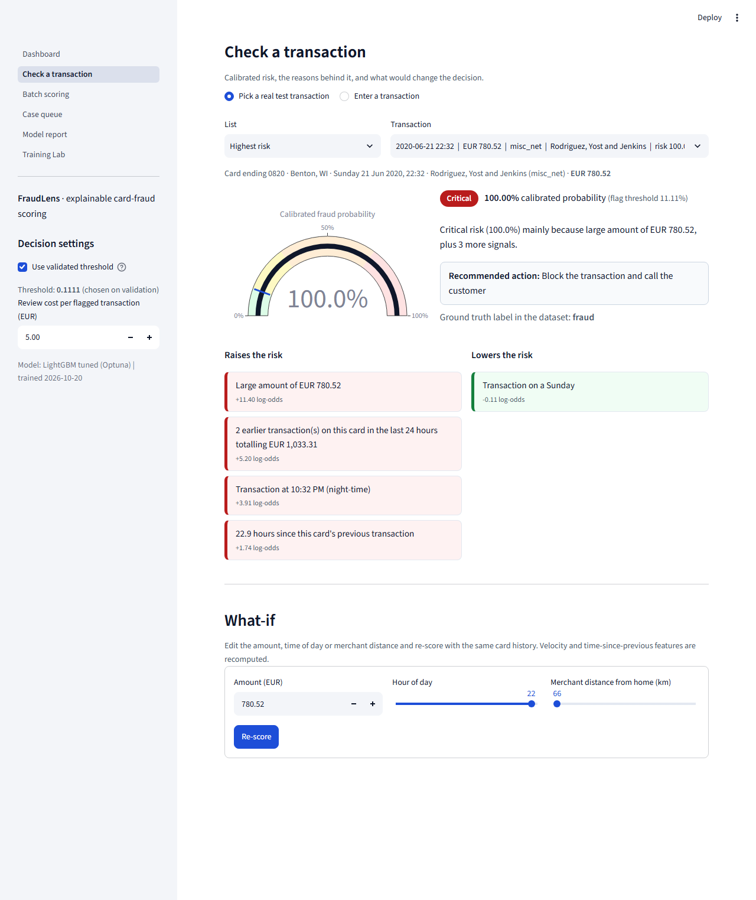
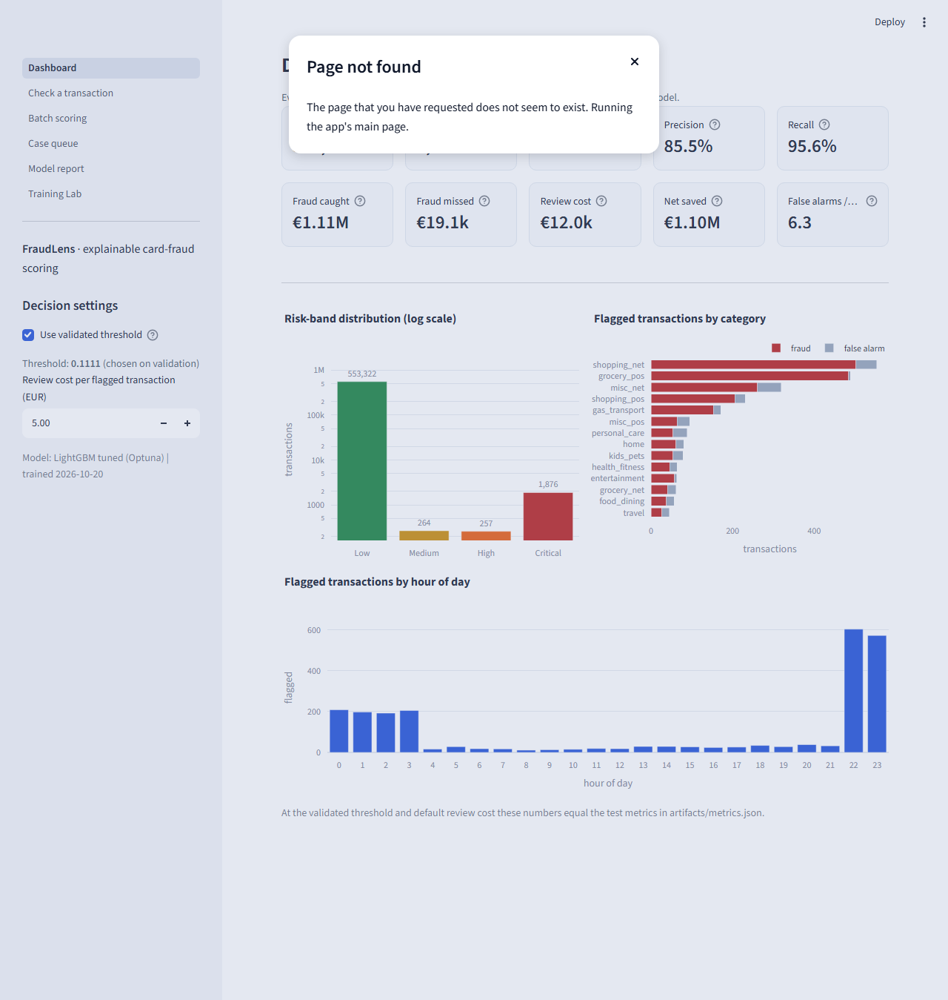
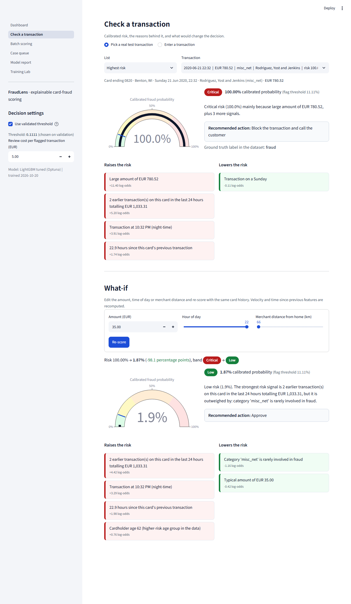
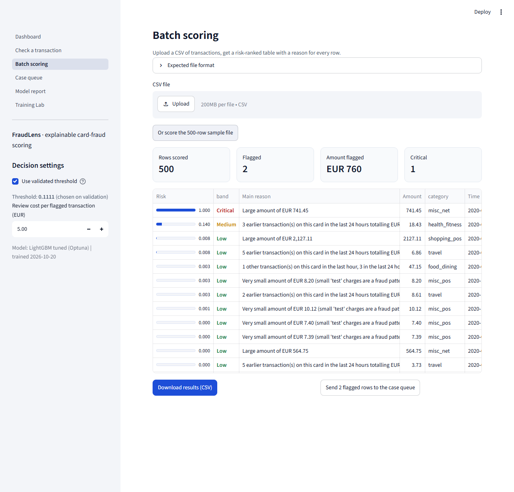
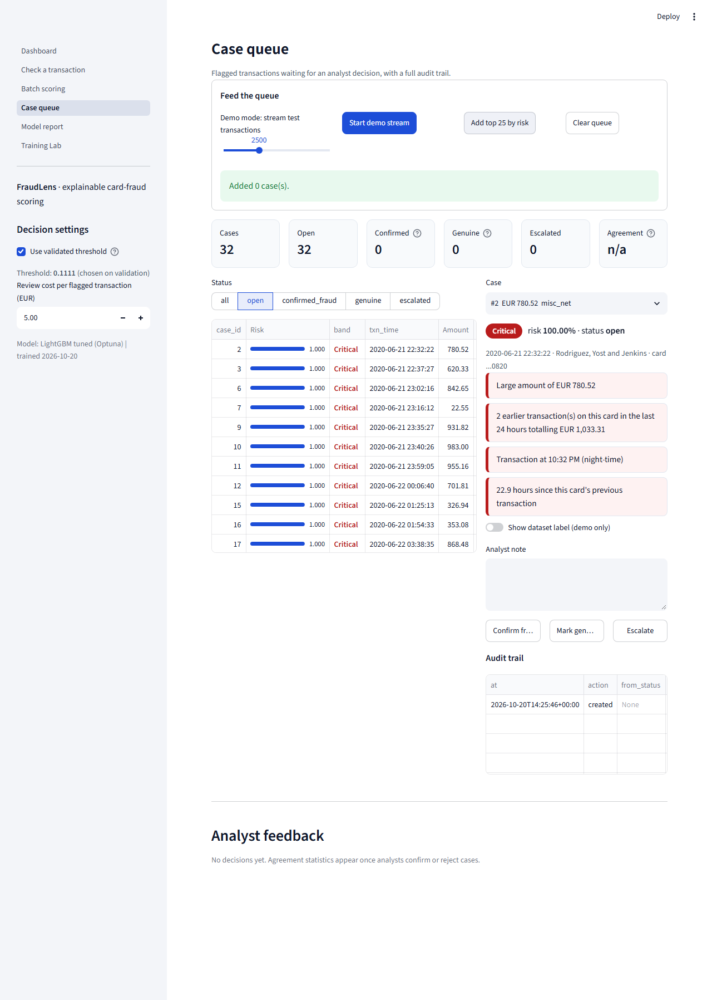
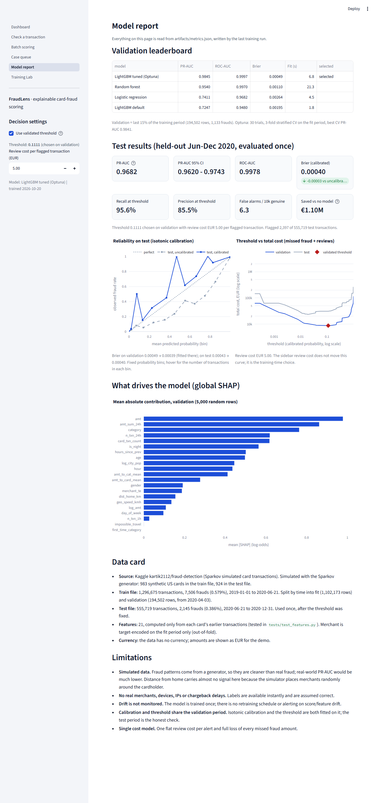
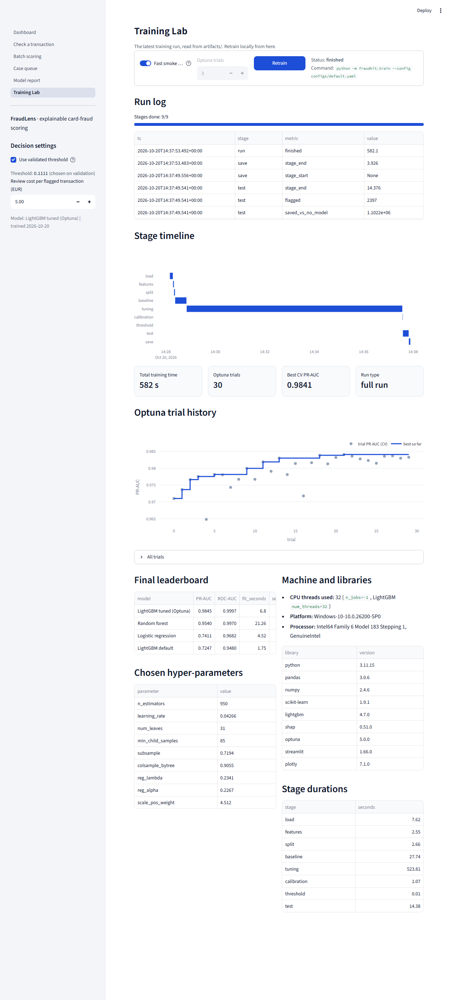

# FraudLens

Credit card fraud detection with **calibrated risk scores** and **plain-English reasons** for every decision.
A LightGBM model scores each transaction, its probability is calibrated so "30%" really means about 30%, and a money-aware
threshold decides what goes to an analyst. Every score comes with reason codes built from SHAP values and the transaction's
actual numbers, e.g. *"Amount is 13.1x what this card usually spends on 'entertainment' (average EUR 47.48)"*.

Everything runs locally (training included) on a normal CPU. Every number in this README and in the app comes from
`artifacts/metrics.json`, written by an actual training run.



## What it does

| Page | What you get |
|---|---|
| Dashboard | KPIs on the held-out test period: transactions scored, flagged, amount at risk, precision/recall, money saved; risk bands, flagged by category and hour |
| Check a transaction | Pick a real test transaction or type one in; risk gauge, band, calibrated probability, red/green reason cards, recommended action, what-if (amount, hour, distance) |
| Batch scoring | Upload a CSV, schema validation with clear errors, risk-ranked table with a reason per row, CSV download, push flagged rows to the case queue |
| Case queue | SQLite queue of flagged transactions; Confirm fraud / Mark genuine / Escalate with notes; audit trail; analyst-agreement stats; **demo mode** streams test transactions into the queue |
| Model report | Leaderboard, test metrics with bootstrap CI, reliability chart, threshold-vs-cost curve, global SHAP importance, data card, limitations |
| Training Lab | Stage timeline, Optuna trial history with running best, leaderboard, chosen hyper-parameters, machine and library info; **Retrain** button that runs training as a subprocess and tails the log live |

Threshold and review cost are adjustable in the sidebar and update every page.

## Architecture

```
                        configs/default.yaml  (seed, split, trials, review cost, risk bands)
                                  |
 Kaggle CSVs --> fraudkit/data.py --> fraudkit/features.py --> fraudkit/train.py --------------------+
 (kagglehub)     load + clean        per-card history features   leaderboard, Optuna, calibration,   |
                                     (past rows only)            money threshold, test once          |
                                                                                                     v
                                                                  artifacts/  model.joblib (FraudModel bundle)
                                                                              metrics.json, trials.csv,
                                                                              training_log.jsonl,
                                                                              test_scored.parquet, history.parquet
                                                                                                     |
        +--------------------------------------+-------------------------------+---------------------+
        v                                      v                               v
 fraudkit/score.py                      fraudkit/explain.py              fraudkit/cases.py
 features -> raw score ->               SHAP -> grouped reason codes     SQLite case queue
 calibrated p -> band/action            with real numbers, what-if       + audit trail
        |                                      |                               |
        +------------------+-------------------+-------------------------------+
                           v                                       v
                 app/ (Streamlit, 6 pages)                  api/main.py (FastAPI POST /score,
                                                            X-API-Key header)
```

`fraudkit/` is plain Python (no Streamlit imports), so the same code serves the app, the API and the tests.

## Setup in 5 commands

From the `fraudlens/` folder (Windows PowerShell shown; on macOS/Linux use `.venv/bin/python`):

```bash
python -m venv .venv
.venv\Scripts\python -m pip install -r requirements.txt
.venv\Scripts\python -m fraudkit.train --config configs/default.yaml
.venv\Scripts\python -m pytest -q
.venv\Scripts\python -m streamlit run app/streamlit_app.py
```

The first training run downloads the public Kaggle dataset `kartik2112/fraud-detection` (about 200 MB) with `kagglehub`;
no Kaggle account was needed for it on the build machine. `--fast` gives a ~30 second smoke run on a sample of cards.
Optional API: `pip install -r requirements-api.txt`, set `FRAUDLENS_API_KEY`, then `uvicorn api.main:app --port 8000`.

## How the training layer works

`python -m fraudkit.train --config configs/default.yaml [--trials N] [--fast]`

1. **load**: the provided `fraudTrain.csv` / `fraudTest.csv` time split is kept (train Jan 2019 - Jun 2020, test Jun - Dec 2020).
2. **features**: 21 features. Card-behaviour features are computed in per-card time order from **strictly earlier**
   transactions only: transactions in the last 1 h / 24 h, 24 h spend, amount vs the card's running average and vs its
   average in this category, time since the previous transaction, km and km/h from the previous merchant (impossible-travel
   flag above 800 km/h), first purchase in a category, card history length. Plus amount, hour, weekday, night flag,
   home-to-merchant distance, age, city population, category, gender, and a smoothed **merchant target encoding**
   fitted on the training period only (out-of-fold for the training rows).
   `tests/test_features.py` proves it: features of row *i* are unchanged when all later rows are deleted or modified.
3. **split**: the last 15% of the training period (by time) is the validation set. The test file is not touched until step 8.
4. **baseline**: logistic regression, random forest, LightGBM with default parameters, all scored on validation.
5. **tuning**: Optuna TPE, 30 trials, PR-AUC, 3-fold stratified CV on the fit period (genuine rows subsampled to 25%
   inside the fit folds for speed, all frauds kept; evaluation folds untouched). The best LightGBM on validation is selected.
6. **calibration**: isotonic regression on validation (Platt if fewer than 300 validation frauds).
7. **threshold**: the threshold that minimises *missed fraud amount + review cost x flagged transactions* on validation.
8. **test**: evaluated once: PR-AUC with a 1,000-resample bootstrap CI, recall, precision, false alarms per 10k genuine,
   money saved versus no model.
9. **save**: model bundle, metrics, scored test set.

The terminal shows a live `rich` view (stage progress bars plus a live Optuna table) and the leaderboard at the end. Every
step is appended to `artifacts/training_log.jsonl`. Everything is seeded and LightGBM runs in deterministic mode;
`tests/test_train_repro.py` trains twice and checks that the metrics match.

## How the explanation layer works

1. SHAP `TreeExplainer` gives each feature's contribution in log-odds; contributions plus the base value reconstruct the
   model's raw output exactly (tested).
2. Related features are grouped (e.g. `amt` + `log_amt`, the three velocity features), so each fact is stated once.
3. Groups that push the risk up by at least 0.05 log-odds become red reasons (top 4); groups that push it down become green
   reasons (top 2). Nothing below the cut-off is mentioned (tested).
4. Each reason is filled in with the transaction's real values (templates such as "Merchant is {km} km from the
   cardholder's home" or "Only {minutes} minutes since this card's previous transaction"), and the wording follows the
   value, not only the SHAP sign.
5. The calibrated probability maps to a band. Medium starts at the money threshold, so "flagged" means "Medium or above".
   High starts at 0.30 and Critical at 0.70. Each band has an action: approve, step-up verification, hold for analyst
   review, block and call the customer.
6. **What-if** re-scores the same transaction with a different amount, hour or merchant distance, recomputing the
   history features against the card's real past.

## Results (actual run)

<!-- RESULTS:START -->
**Validation leaderboard** (last 15% of the training period, 194,502 transactions, 1,133 frauds)

| Model | PR-AUC | ROC-AUC | Brier | Fit time (s) |
|---|---|---|---|---|
| **LightGBM tuned (Optuna)** (selected) | 0.9845 | 0.9997 | 0.00049 | 6.8 |
| Random forest | 0.9540 | 0.9970 | 0.00110 | 21.3 |
| Logistic regression | 0.7411 | 0.9682 | 0.00264 | 4.5 |
| LightGBM default | 0.7247 | 0.9480 | 0.00195 | 1.8 |

Optuna: 30 trials, 3-fold stratified CV, best CV PR-AUC 0.9841.

**Test set** (555,719 transactions from 2020-06-21 to 2020-12-31, 2,145 frauds), evaluated once:

| Metric | Value |
|---|---|
| PR-AUC (95% bootstrap CI) | 0.9682 (0.9620 - 0.9743), 1000 resamples |
| ROC-AUC | 0.9978 |
| Brier score, uncalibrated -> calibrated | 0.00043 -> 0.00040 (isotonic) |
| Decision threshold (chosen on validation) | 0.1111 (review cost 5 per alert) |
| Recall at threshold | 95.6% |
| Precision at threshold | 85.5% |
| False alarms per 10,000 genuine | 6.3 |
| Transactions flagged | 2,397 |
| Fraud amount in test period | 1,133,325 |
| Cost with model (missed fraud + reviews) | 19,119 + 11,985 = 31,104 |
| **Saved vs no model** | **1,102,221** |

Full training run: 582 s on 32 CPU threads (Windows-10-10.0.26200-SP0).
<!-- RESULTS:END -->

## Screenshots

| | |
|---|---|
|  |  |
|  |  |
|  |  |

## Limitations (read before showing to a client)

- **Simulated data.** The Sparkov generator produces cleaner fraud patterns than real life (night-time, large online
  purchases, bursts). Real-world PR-AUC would be far lower; these numbers show that the pipeline works, not how it would
  perform on a bank's data.
- **Signals the simulator lacks.** No devices, IPs, real merchants, chargeback delays or label noise. Home-to-merchant
  distance carries almost no signal because the simulator places merchants randomly around each cardholder.
- **Drift is not monitored**, and there is no retraining schedule.
- **Calibration and threshold share the validation period.** The test period is the independent check.
- **One cost model.** A flat review cost per alert and full loss of every missed fraud amount. The data has no
  currency; amounts are shown as EUR.
- Out of scope: login/auth, multi-tenancy, cloud deployment.

## Repository layout

```
fraudlens/
  fraudkit/      data.py features.py train.py score.py explain.py costs.py cases.py
  app/           streamlit_app.py, common.py, pages/1..6
  api/           main.py (FastAPI, optional)
  tests/         features (leakage), explanations, case queue, reproducibility, app click-through, API
  configs/       default.yaml
  artifacts/     metrics.json, trials.csv, training_log.jsonl (committed); model + parquet files (git-ignored)
  scripts/       screenshots.py (Playwright), results_table.py (README table from metrics.json)
  docs/          screenshots
```
