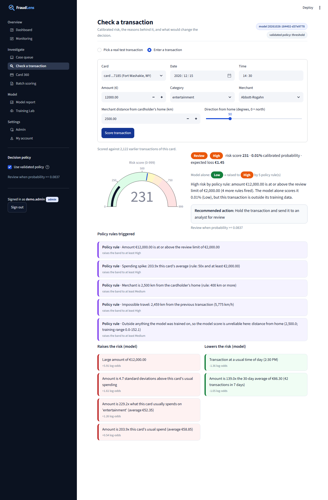
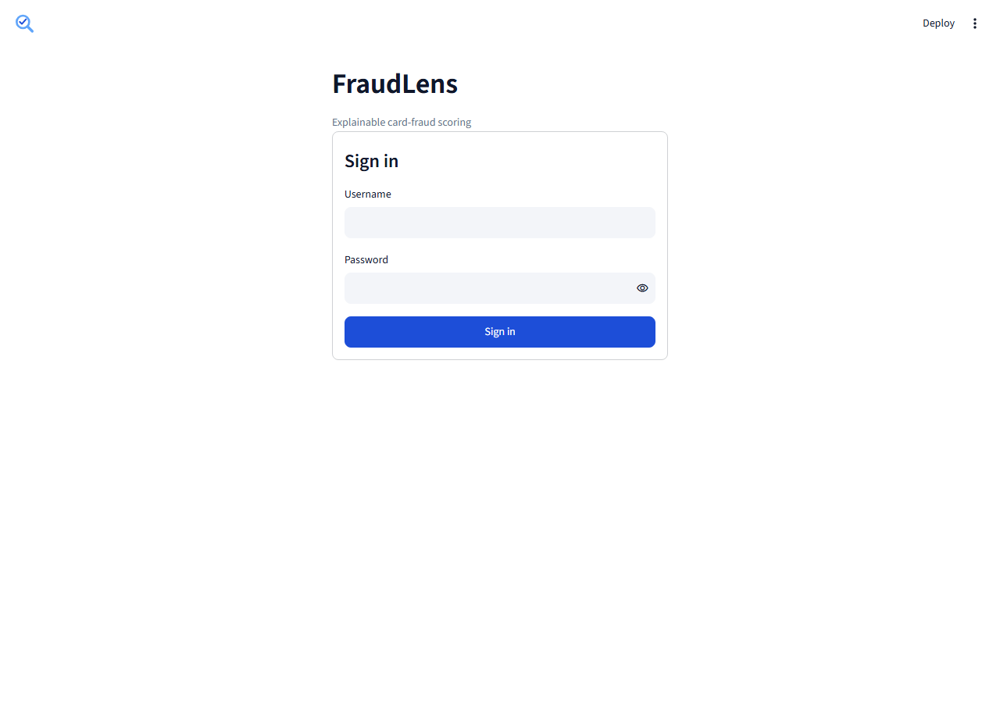
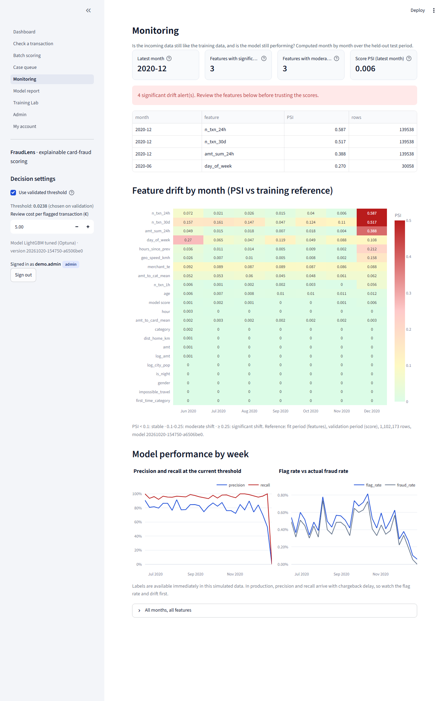
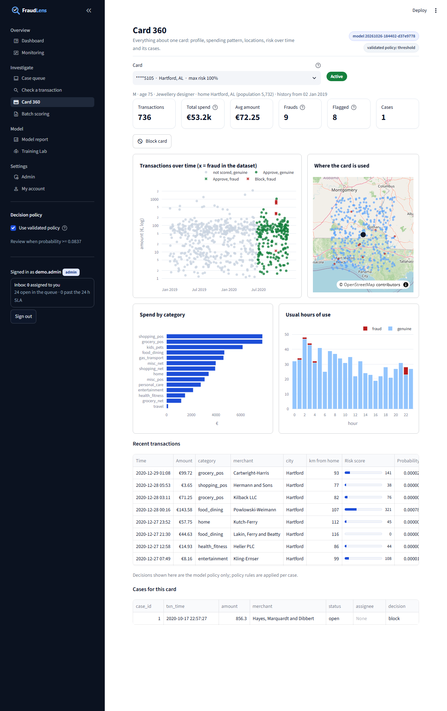

# FraudLens

Credit card fraud detection with **calibrated risk scores** and **plain-English reasons** for every decision, packaged as a
secured analyst application and a scoring API.

A LightGBM model scores each transaction. Its probability is calibrated, so "30%" really means about 30%, and a
money-aware threshold decides what goes to an analyst. Every score comes with reason codes built from SHAP values and the
transaction's actual numbers, e.g. *"Amount is 13.1x what this card usually spends on 'entertainment' (average €47.48)"*.
Analysts work the flagged transactions in a case queue with assignment and a full audit trail. Admins manage users, API
keys and retraining, and everyone can watch data drift and model performance.

Everything runs locally (training included) on a normal CPU. Every number in this README and in the app comes from
`artifacts/metrics.json`, written by an actual training run.

**Viva report (PDF):** [docs/FraudLens_Viva_Report.pdf](docs/FraudLens_Viva_Report.pdf) covers the algorithms used, where
they are used, how the models are compared, all results, and viva questions with answers. It is generated from the
training artifacts by `scripts/build_report.py`.


## What it does

| Page | What you get | Who |
|---|---|---|
| Dashboard | KPIs on the held-out test period: transactions scored, flagged, amount at risk, precision/recall, money saved; risk bands, flagged by category and hour | all |
| Check a transaction | Pick a real test transaction or type one in; risk gauge, band, calibrated probability, red/green reason cards, recommended action, what-if (amount, hour, distance) | all (what-if and manual entry: analyst+) |
| Batch scoring | Upload a CSV, schema validation with clear errors, risk-ranked table with a reason per row, CSV download (formula-safe), push flagged rows to the case queue | analyst+ |
| Case queue | Flagged transactions with assign-to-me, Confirm fraud / Mark genuine / Escalate with notes, case age, per-case audit trail, CSV export, analyst-agreement stats; **demo mode** streams test transactions in | view: all, act: analyst+, clear: admin |
| Monitoring | Monthly **data drift** (PSI per feature and for the score vs the training reference), drift alerts, weekly precision/recall/flag rate | all |
| Model report | Leaderboard, test metrics with bootstrap CI, reliability chart, threshold-vs-cost curve, global SHAP importance, data card, limitations | all |
| Training Lab | Stage timeline, Optuna trial history, leaderboard, hyper-parameters, machine info; **Retrain** runs training as a subprocess and tails the log live | view: all, retrain: admin |
| Admin | Users (create, role, enable/disable, reset password), API keys (create once-shown keys, revoke, usage), audit log with filters and export, system status and model versions | admin |
| My account | Role and permissions, change password | all |

Threshold and review cost are adjustable in the sidebar and update every page.

## Architecture

```
                        configs/default.yaml (validated with pydantic at start-up)
                                  |
 Kaggle CSVs --> fraudkit/data.py --> fraudkit/features.py --> fraudkit/train.py -------------------------+
 (kagglehub)     load + clean        per-card history features   leaderboard, Optuna, calibration,        |
                                     (past rows only)            money threshold, test once, drift profile |
                                                                                                          v
                                       artifacts/ (written atomically, versioned <UTC time>-<sha256>)
                                       model.joblib  metrics.json  reference_profile.json  runs/<version>/
                                       trials.csv  training_log.jsonl  test_scored.parquet  history.parquet
                                                                                                          |
    +-------------------------+--------------------------+------------------------+----------------------+
    v                         v                          v                        v
 score.py                 explain.py                 monitoring.py            db.py / auth.py / cases.py
 features -> raw score    SHAP -> grouped reason     PSI drift vs the         SQLite (WAL, migrations):
 -> calibrated p ->       codes with real numbers,   training reference       users (PBKDF2), roles, lockout,
 band / action            what-if                                             API keys (hashed), cases, audit
    |                         |                          |                        |
    +-------------+-----------+--------------------------+------------------------+
                  v                                                    v
     app/ Streamlit (login + roles, 9 pages)            api/main.py FastAPI /v1 (API keys, rate limit,
                                                        request IDs, JSON logs)
```

`fraudkit/` is plain Python (no Streamlit imports), so the same code serves the app, the API, the CLI and the tests.

## Setup

From the `fraudlens/` folder (Windows PowerShell shown; on macOS/Linux use `.venv/bin/python`):

```bash
python -m venv .venv
.venv\Scripts\python -m pip install -r requirements.txt -r requirements-api.txt
.venv\Scripts\python -m fraudkit.train --config configs/default.yaml
.venv\Scripts\python -m pytest -q
.venv\Scripts\python -m streamlit run app/streamlit_app.py
```

The first training run downloads the public Kaggle dataset `kartik2112/fraud-detection` (about 200 MB) with `kagglehub`;
no Kaggle account was needed for it on the build machine. `--fast` gives a ~30 second smoke run on a sample of cards.

**First start:** the app asks you to create the first administrator account. That admin then creates the other users
(Admin -> Users) with temporary passwords that must be changed at first sign-in. On a server without a browser, use the CLI:

```bash
.venv\Scripts\python -m fraudkit.admin create-user alice --role admin
```

### Scoring API

```bash
.venv\Scripts\python -m uvicorn api.main:app --port 8000
```

Create a key in **Admin -> API keys** (or `python -m fraudkit.admin create-api-key "checkout-service"`), then send it in
the `X-API-Key` header:

| Endpoint | Auth | Purpose |
|---|---|---|
| `POST /v1/score` | key | 1 to `api.max_batch` transactions -> probability, band, flag, action, summary, reasons, `model_version`, `request_id` |
| `GET /v1/model` | key | Served model version, threshold, bands, features, headline test metrics |
| `GET /v1/health` | none | Liveness |
| `GET /v1/ready` | none | Model loaded and database reachable |

Interactive docs at `http://localhost:8000/docs`. Keys are rate-limited per minute (`api.rate_limit_per_minute`, HTTP 429
with `Retry-After`). The API hot-reloads the model when a retrain swaps in a new version.

### Docker

```bash
cp .env.example .env
docker compose up --build
```

This runs the API on `127.0.0.1:8000` and the app on `127.0.0.1:8501`, as a non-root user with health checks. Users, keys
and cases live in a named volume, and `./artifacts` is mounted read-only (train on the host first).

### Hosted demo (Hugging Face Spaces)

```bash
uv pip install -r requirements-deploy.txt
python scripts/deploy_space.py
```

This asks for a Write and a Read token from a free Hugging Face account, then puts the code in a public Docker Space and
the model and data in a private dataset repo. Sign-in passwords are generated and saved to `deploy/credentials.txt`
(git-ignored). The `demo` account is an analyst and `admin` is the administrator. The free tier has no persistent disk,
so cases reset on restart, and a Space sleeps after a period without visitors (the next visit wakes it).

### Continuous integration

`.github/workflows/fraudlens-ci.yml` runs `ruff check`, `ruff format --check` and `pytest` on every push that touches
`fraudlens/`. Tests that need the Kaggle data or a trained model skip themselves there.

## How the training layer works

`python -m fraudkit.train --config configs/default.yaml [--trials N] [--fast]`

1. **load**: the provided `fraudTrain.csv` / `fraudTest.csv` time split is kept (train Jan 2019 - Jun 2020, test Jun - Dec 2020).
2. **features**: 21 features. Card-behaviour features are computed in per-card time order from **strictly earlier**
   transactions only:
   - transactions in the last 1 h / 24 h and 24 h spend;
   - amount vs the card's running average and vs its average in this category;
   - time since the previous transaction;
   - km and km/h from the previous merchant, with an impossible-travel flag above 800 km/h;
   - first purchase in a category, and card history length.

   Plus amount, hour, weekday, night flag, home-to-merchant distance, age, city population, category, gender, and a
   smoothed **merchant target encoding** fitted on the training period only (out-of-fold for the training rows).
   `tests/test_features.py` proves it: features of row *i* are unchanged when all later rows are deleted or modified.
3. **split**: the last 15% of the training period (by time) is the validation set. The test file is not touched until step 8.
4. **baseline**: logistic regression, random forest, LightGBM with default parameters, all scored on validation.
5. **tuning**: Optuna TPE, 30 trials, PR-AUC, 3-fold stratified CV on the fit period. Inside the fit folds, genuine rows
   are subsampled to 25% for speed; all frauds are kept and the evaluation folds are untouched. The best LightGBM on
   validation is selected.
6. **calibration**: isotonic regression on validation (Platt if fewer than 300 validation frauds).
7. **threshold**: the threshold that minimises *missed fraud amount + review cost x flagged transactions* on validation.
8. **test**: evaluated once: PR-AUC with a 1,000-resample bootstrap CI, recall, precision, false alarms per 10k genuine,
   money saved versus no model.
9. **save**: the model bundle with its version id, metrics, the drift reference profile and the scored test set, all
   staged and swapped in atomically. Metrics and trials are archived under `artifacts/runs/<version>/`.

The terminal shows a live `rich` view (stage progress bars plus a live Optuna table) and the leaderboard at the end. Every
step is appended to `artifacts/training_log.jsonl`. Everything is seeded and LightGBM runs in deterministic mode;
`tests/test_train_repro.py` trains twice and checks that the metrics match.

## How the explanation layer works

1. SHAP `TreeExplainer` gives each feature's contribution in log-odds; contributions plus the base value reconstruct the
   model's raw output exactly (tested).
2. Related features are grouped (e.g. `amt` + `log_amt`, the three velocity features), so each fact is stated once.
3. Groups that push the risk up by at least 0.05 log-odds become red reasons (top 4 by default); groups that push it down
   become green reasons (top 2). Nothing below the cut-off is mentioned (tested).
4. Each reason is filled in with the transaction's real values (templates such as "Merchant is {km} km from the
   cardholder's home" or "Only {minutes} minutes since this card's previous transaction"), and the wording follows the
   value, not only the SHAP sign.
5. The calibrated probability maps to a band. Medium starts at the money threshold, so "flagged" means "Medium or above".
   High starts at 0.30 and Critical at 0.70. Each band has an action: approve, step-up verification, hold for analyst
   review, block and call the customer. App and API take the bands from the same config.
6. **What-if** re-scores the same transaction with a different amount, hour or merchant distance, recomputing the
   history features against the card's real past.

## Model v3: research-based features and smooth calibration

**Why scores looked like 0% or 100%.** The calibrator was isotonic regression, a step function: about 95% of test
transactions got exactly 0% and the riskiest exactly 100%, with only 94 distinct values for 555,719 transactions. The
model's ranking was fine; the calibrator threw the resolution away. Training now compares isotonic, Platt and beta
calibration on two time-halves of validation and keeps the lowest out-of-sample log-loss
(**platt**). The test set now has **522,809 distinct probabilities**. A **risk score
0-999** on a log-odds scale (about 33 points doubles the odds, like a credit score) makes very small and very large
probabilities readable.

**Features from the fraud literature**, each tested on validation (`scripts/feature_ablation.py`, two seeds):
- spending windows over 1, 7 and 30 days, in the RFM style of the
  [Fraud Detection Handbook](https://fraud-detection-handbook.github.io/fraud-detection-handbook/Chapter_3_GettingStarted/BaselineFeatureTransformation.html);
- a z-score of the amount against the card's own history;
- card-testing probes: small charges under €5 before a large one;
- merchant velocity;
- merchant and category fraud risk with a 7-day label delay;
- weekend and circular hour.

All research groups together raised validation PR-AUC from 0.9847 to
0.9864 (seed noise
0.0005). The simplest set that matched it was kept: spending windows, the z-score and
card-testing probes.

The retuned model scores validation PR-AUC **0.9872** (was 0.9844) and test PR-AUC
**0.9765** (95% CI 0.9719-0.9811; was 0.9722). Test ROC-AUC is
0.9995, with precision 83.5% (was 81.1%) and 7.3 false
alarms per 10k genuine (was 8.7). Recall is 95.9% (was 96.4%). Total cost at the threshold chosen on
validation is 30,137 (was 28,734): ranking improved, while the validation-chosen threshold moved
from 0.0238 to 0.0837.

## Decision policy: flat threshold or expected loss

`fraudkit/decision.py` turns the calibrated probability into one of four actions: **approve**, **step-up**
(the cardholder verifies), **review** (analyst) or **block**. Two policies are evaluated on validation:
- **flat threshold:** review when p >= 0.0238;
- **expected loss:** review when p x amount >= k x review cost, with k tuned on validation (k = 3).

The cheaper one on validation is served (`decision.mode: auto`):

| Policy | Validation cost | Test cost | Test recall |
|---|---|---|---|
| Flat threshold (served) | 8,838 | 28,734 | 96.4% |
| Expected loss | 9,338 | 24,473 | 92.8% |

On the test period expected loss would have been cheaper, but the choice is made on validation only; the sidebar
lets you switch policy and see the effect live.

Three card-profile features (amount vs the card's previous maximum, category share, hour share) were tested in a
two-seed validation ablation (`scripts/feature_ablation.py`, `artifacts/feature_ablation.json`). None beat the seed
noise, so they are used for explanations, rules and Card 360, not as model inputs.

## Analyst workflow

- **Case queue:** board view (New, In progress, Escalated, Closed) and table view with bulk actions. Cases are
  prioritised by expected loss, with an SLA timer (`decision.sla_hours`) and overdue flags, comments, and a full
  audit trail.
- **Card 360:** the card's transactions over time, a map of where it is used versus home, spend by category, usual
  hours, recent activity and its cases.
- **Watchlists:** confirming fraud blocks the card (stored as a SHA-256 hash), so later transactions are blocked by a
  rule. Analysts can also watch a merchant (its transactions go to review). Admins manage both lists.
- **Notifications:** the sidebar inbox shows cases assigned to you and how many are past the SLA.

## Policy rules (guardrail for model blind spots)

A model only learns what is in its data. In this simulated dataset every fraud is at most about €1,400 and every
merchant is within about 150 km of home. A €12,000 purchase 2,500 km away therefore scores 0.0% with the model alone.
FraudLens adds policy rules (`configs/default.yaml -> rules`, `fraudkit/rules.py`). The limits are `auto` by default:
derived from the data at training time (review amount €2,000, far from home 400 km),
and the spending-spike rule is tuned on validation (50x and €2,000).
The rules cover:
- large amount, extreme spending spike, far from home, long-distance impossible travel, transaction burst;
- any key feature outside the range seen in training.

Rules can only raise the risk band, never lower it. Each hit is shown as its own reason, and the app and API report
both the model band and the final band.



The rules were measured on the test set like everything else; the impact table is in the Model report and in the PDF.
On this simulated data they add about 600 reviews and catch no extra fraud, because the simulator never produces fraud
of that kind. That is the price of protection outside the training data. Two looser rule versions were rejected after
measuring them:
- a plain impossible-travel flag fired 15,074 times for 1 extra fraud;
- a 10x spending-spike rule added 2,398 reviews for 10 frauds.

## Monitoring

Training saves a reference profile: decile bin edges and shares of every feature on the fit period, plus the score
distribution on validation. The Monitoring page bins each month of incoming data the same way and reports the
**Population Stability Index**: < 0.10 stable, 0.10-0.25 moderate, >= 0.25 significant (alert). It also tracks weekly
precision, recall and flag rate. In production, labels arrive late (chargebacks), so the flag rate and drift are the
early signals.

The first run of the monitor found a real defect. The original feature `card_txn_count` (a card's lifetime number of
transactions) only ever grows, so it left the training range (PSI 3.7-6.1 in every test month). It was the model's 5th
most important feature, so the model trusted cards more the older they got. It was replaced with the stationary
`n_txn_30d` (transactions in the previous 30 days). On the same untouched test set, PR-AUC rose from 0.9682 to 0.9722,
recall from 95.6% to 96.4%, and the saving from 1,102,221 to 1,104,591; precision moved from 85.5% to 81.1% at the
new money-optimal threshold. The remaining alerts are December's holiday spending surge (`n_txn_24h`, `n_txn_30d`,
`amt_sum_24h`), which is exactly what the monitor should flag.

## Security and access control

Local accounts with PBKDF2 password hashing, lockout after repeated failures, session timeout, and three roles
(viewer, analyst, admin) enforced server-side. API keys are hashed and revocable, with per-key rate limits. Admin,
security and case events are audit-logged. Card numbers are masked to the last four digits in the case store.
Data-derived text is HTML-escaped, and CSV exports are protected against formula injection.
See [SECURITY.md](SECURITY.md) for the full list and for what is still needed before handling real card data.

## Results (actual run)

<!-- RESULTS:START -->
**Validation leaderboard** (last 15% of the training period, 194,502 transactions, 1,133 frauds)

| Model | PR-AUC | ROC-AUC | Brier | Fit time (s) |
|---|---|---|---|---|
| **LightGBM tuned (Optuna)** (selected) | 0.9872 | 0.9998 | 0.00053 | 5.4 |
| Random forest | 0.9570 | 0.9962 | 0.00098 | 35.9 |
| LightGBM default | 0.7977 | 0.9580 | 0.00173 | 2.5 |
| Logistic regression | 0.7597 | 0.9814 | 0.00231 | 6.8 |

Optuna: 30 trials, 3-fold stratified CV, best CV PR-AUC 0.9866.

**Test set** (555,719 transactions from 2020-06-21 to 2020-12-31, 2,145 frauds), evaluated once:

| Metric | Value |
|---|---|
| PR-AUC (95% bootstrap CI) | 0.9765 (0.9719 - 0.9811), 1000 resamples |
| ROC-AUC | 0.9995 |
| Brier score, uncalibrated -> calibrated | 0.00050 -> 0.00037 (platt) |
| Decision threshold (chosen on validation) | 0.0837 (review cost 5 per alert) |
| Recall at threshold | 95.9% |
| Precision at threshold | 83.5% |
| False alarms per 10,000 genuine | 7.3 |
| Transactions flagged | 2,463 |
| Fraud amount in test period | 1,133,325 |
| Cost with model (missed fraud + reviews) | 17,822 + 12,315 = 30,137 |
| **Saved vs no model** | **1,103,188** |

Full training run: 1,236 s for the identical model (archived run 20261025-233115-3abe0ebd; the final run's wall-clock time includes the computer sleeping) on 32 CPU threads (Windows-10-10.0.26300-SP0).
<!-- RESULTS:END -->

## Screenshots

| | |
|---|---|
|  |  |
|  |  |
|  |  |
|  |  |

## Limitations (read before showing to a client)

- **Simulated data.** The Sparkov generator produces cleaner fraud patterns than real life (night-time, large online
  purchases, bursts). Real-world PR-AUC would be far lower; these numbers show that the pipeline works, not how it would
  perform on a bank's data.
- **Signals the simulator lacks.** No devices, IPs, real merchants, chargeback delays or label noise. Home-to-merchant
  distance carries almost no signal because the simulator places merchants randomly around each cardholder.
- **Calibration and threshold share the validation period.** The test period is the independent check.
- **One cost model.** A flat review cost per alert and full loss of every missed fraud amount. The data has no
  currency; amounts are shown in euros.
- **Single-node MVP.** Local accounts (no SSO/MFA), SQLite, an in-process rate limiter and no TLS termination. Retraining
  is manual, with no approval gate. [SECURITY.md](SECURITY.md) lists what to add for production.

## Repository layout

```
fraudlens/
  fraudkit/   data features train score explain costs     (ML core)
              config db auth cases monitoring security     (platform)
              admin                                        (operator CLI)
  app/        streamlit_app.py (login + navigation), common.py, views/ (9 pages)
  api/        main.py (FastAPI /v1)
  tests/      leakage, explanations, auth/roles/keys, config, drift, security helpers, migrations,
              reproducibility, app click-through per role, API
  configs/    default.yaml
  artifacts/  metrics.json, trials.csv, training_log.jsonl, reference_profile.json, runs/ (committed);
              model + parquet files (git-ignored)
  scripts/    screenshots.py (Playwright), results_table.py (README table from metrics.json)
  docs/       screenshots
  Dockerfile, docker-compose.yml, pyproject.toml (ruff, pytest), SECURITY.md, .env.example
```
